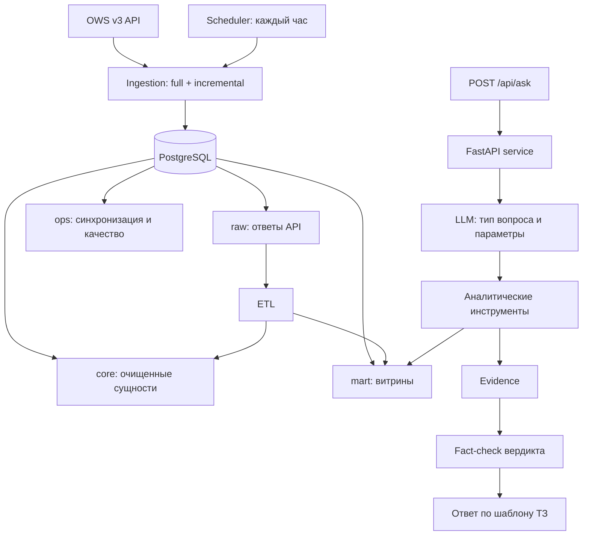

# Архитектура

**Принцип:** LLM определяет тип вопроса, вызывает инструменты и пишет вердикт в 1–3 предложения.
Все расчёты делают SQL и Python. Остальные разделы ответа код собирает из результатов инструментов (`Evidence`).
Числа вердикта сверяются с Evidence; при расхождении модель переписывает вердикт, а если ошибка повторяется — ответ получает пометку ⚠.

## Сущности OWS v3

| Сущность | Источник | Зачем |
|---|---|---|
| План | GraphQL `Plans` + `PlansKato`, `RefEnstru` | ЕНС ТРУ, ед. изм., количество, место поставки (КАТО); база для анализа объёмов |
| Объявления | GraphQL `TrdBuy`, REST `/trd-buy/{id}` | способ закупки, статус, дата |
| Лоты | GraphQL `Lots` | количество, сумма, связь с планом, номер лота |
| Договоры | GraphQL `Contract` + `ContractUnits` | **фактическая цена за единицу** и количество, поставщик, версии |
| Участники | REST `/subject/biin/{bin}` | заказчики и поставщики |
| Справочники | REST `/refs/*` | ед. изм., КАТО, способы, статусы, вид ТРУ |
| ИПЦ РК | Бюро нац. статистики | поправка на инфляцию |

Цены сравниваются по позициям договоров: это фактические цены сделок, а не плановые суммы лотов.
GraphQL выбран, потому что только он отдаёт позиции договоров и связи с планом. REST используется для справочников и точечных запросов.

## Ingestion

- **Полная загрузка:** 27 БИН × 2024–2026, асинхронно, с backoff на 429/5xx и курсорной пагинацией.
- **Инкремент:** у каждого БИН и сущности свой watermark; запрашиваются записи с `lastUpdateDate ≥ watermark − 1 день`, запись через upsert.
- **Свежесть ≤ 24 ч:** планировщик (Docker или k8s CronJob) раз в час запускает инкремент и пересборку витрин.

## Хранение

`raw` (jsonb как есть) → `core` (очистка и нормализация) → `mart` (витрины) + `ops` (служебное). ETL полностью пересобирает
`core` и `mart` SQL-скриптами за ~10 с. Подробнее — [DATA_MODEL.md](DATA_MODEL.md).

## Агент

- **Провайдеры:** Claude API или любой OpenAI-совместимый API: on-prem Ollama/vLLM для закрытого контура либо облачные Gemini/OpenAI.
- **Инструменты:** `assess_fair_price`, `find_price_anomalies`, `detect_volume_anomalies`, `search_procurements`, `aggregate`,
  справочные lookup-инструменты, `run_sql` (read-only роль БД) и `final_answer`.
- **Язык:** ответ на языке вопроса (RU/KZ).
- **Журнал:** каждый ответ с Evidence и трассой вызовов сохраняется в `ops.qa_log`.

## Нефункциональные требования

| Требование | Реализация |
|---|---|
| Качество данных | 10 автоматических проверок после каждой сборки, отчёт в `ops.dq_report` и `GET /api/dq` |
| Защита токенов | токены только в `.env` / k8s Secret, не логируются; SQL агента под ролью `agent_ro` (только чтение); CORS по списку |
| On-prem | Docker Compose и манифесты Kubernetes; LLM можно запускать внутри контура |
