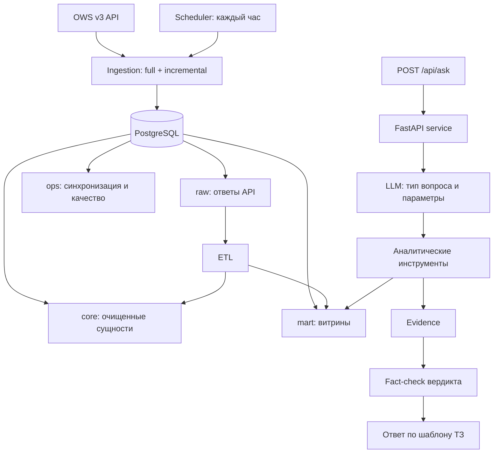

# Архитектура

## 1. Общая схема

**Ключевой принцип:** LLM не выполняет вычислений. Она (1) классифицирует вопрос и извлекает параметры,
(2) вызывает детерминированные инструменты (SQL/Python), (3) пишет вердикт из 1–3 предложений по готовым числам.
Все разделы ответа, кроме вердикта (данные, аналитика, метрика, уверенность, Top-K), собирает код из
результатов инструментов (`Evidence`). Числа вердикта сверяются с Evidence (`fact_check`). Если в вердикте
есть число, которого нет в расчётах, модель один раз переписывает вердикт. Если ошибка повторяется,
в ответе появляется пометка ⚠.

## 2. Выбор сущностей OWS v3 и обоснование

| Сущность ТЗ | Источник OWS v3 | Зачем |
|---|---|---|
| План | GraphQL `Plans` (+`PlansKato`, `RefEnstru`) | ЕНС ТРУ, ед. изм., плановая цена и количество, **место поставки (КАТО)**, месяц. Это база для «объёмов» и источник ед. изм. и региона для договоров |
| Объявления | GraphQL `TrdBuy`, REST `/v3/trd-buy/{id}` | способ закупки, статус, дата публикации, организатор |
| Лоты | GraphQL `Lots` | количество, сумма, связь с пунктами плана (`pointList`), КАТО поставки, номер лота для вопросов «лот №…» |
| Договоры | GraphQL `Contract` + `ContractUnits` | **фактическая цена за единицу** (`itemPrice`) и количество по каждой позиции, поставщик, статус, версии (`rootId`) |
| Вид предмета (товары/услуги/работы) | `refSubjectTypeId` (план/объявление), справочник `ref_subject_type` | разделение ТРУ |
| Заказчики / поставщики | REST `/v3/subject/biin/{bin}` | названия, резидентство, КАТО |
| Статусы / результаты | `ref_buy_status`, `ref_lots_status`, `ref_contract_status`, `ref_pln_point_status` | фильтр состоявшихся договоров |
| Справочники | `ref_units`, `ref_kato`, `ref_trade_methods`, `ref_finsource`, `ref_months`, `ref_contract_type` | нормализация ед. изм., регионы, способы |
| Внешний справочник | ИПЦ РК помесячно (Бюро нац. статистики) | временной фактор Fair Price |

**Почему основа цен — позиции договоров, а не лоты.** Лот содержит выделенную (плановую) сумму, договор содержит
фактическую цену, по которой реально заключили сделку. Для оценки справедливости и аномалий сравниваются фактические
цены. Плановая цена лота показывается рядом, а если договора по лоту ещё нет, оценивается она (это указывается в ограничениях).

**Почему GraphQL.** В REST нет позиций договоров и связей с планом. GraphQL отдаёт вложенные `ContractUnits`,
`PlansKato` и `RefEnstru` в одном запросе и поддерживает фильтры `customerBin`, `finYear`, `lastUpdateDate`.
REST используется для справочников и точечных запросов по id или БИН: там это на порядок быстрее.

## 3. Ingestion

* `app/ingest/client.py`: асинхронный клиент (httpx) с семафором конкурентности (6), экспоненциальным backoff на
  429/5xx и курсорной пагинацией GraphQL (`after=lastId`, страница 500).
* **Полная загрузка** (`python -m app.ingest.jobs full`): для каждого из 27 БИН параллельно загружаются
  Plans (по годам 2024–2026), Contract+Units (`finYear` 2024–2026), Lots и TrdBuy. Затем догружаются
  объявления, где организатор не входит в список, и карточки всех поставщиков. Основные сущности загружаются примерно за 4 минуты.
* **Инкремент** (`python -m app.ingest.jobs incremental`): по каждому БИН и сущности хранится watermark в `ops.sync_state`.
  Запрашиваются записи с `lastUpdateDate` (у планов `timestamp`) **≥ watermark − 1 день**. Нахлёст в сутки защищает
  от пропусков при задержке индексации на портале. Запись идёт upsert по `id`, поэтому повторы безопасны.
* **SLA свежести ≤ 24 ч:** планировщик (`app.ingest.scheduler` в Docker или `CronJob` в k8s) запускает инкремент
  и пересборку витрин **каждый час**. Задержка складывается из этого часа и времени индексации на самом портале
  (`index_date`), то есть остаётся с большим запасом внутри 24 часов. Проверка `data_freshness_hours` в отчёте
  качества срабатывает, если с последней успешной синхронизации прошло больше 24 часов.

## 4. Слои хранения

См. [DATA_MODEL.md](DATA_MODEL.md). Коротко:
`raw` (jsonb как есть) → `core` (типизация, последние версии, очистка названий, нормализация ед. изм., КАТО) →
`mart` (витрины `price_obs`, `enstru_stats`, `enstru_unit_mode`, `region_coef`, `season_coef`, `lot_price`, `volume_yearly`) + `ops`.
ETL полностью пересобирает `core` и `mart` из `raw` SQL-скриптами (`backend/sql/*.sql`) примерно за 10 секунд,
поэтому пересборка идемпотентна и воспроизводима.

## 5. AI-агент

* Цикл tool use (`app/agent/agent.py`) общий для двух провайдеров (`app/agent/llm.py`):
  * `anthropic`: Claude (по умолчанию `claude-opus-5-5`), adaptive thinking, кэширование системного промпта, серверный fallback при отказе модели;
  * `openai_compat`: любой OpenAI-совместимый API. Для закрытого контура это **on-prem** модель (Ollama, vLLM), данные
    не покидают инфраструктуру. Для разработки подходят облачные API (Gemini, OpenAI, Groq). Сообщение ассистента
    возвращается в историю целиком, со служебными полями провайдера (например, `thought_signature` у Gemini), без них
    многошаговый tool use у Gemini 3 не работает.
* Инструменты (`app/agent/tools.py`): `find_price_anomalies`, `assess_fair_price`, `detect_volume_anomalies`,
  `search_procurements`, `aggregate`, `lookup_enstru`, `lookup_customer`, `list_customers`, `run_sql` и `final_answer`.
  `run_sql` выполняется под отдельной ролью БД `agent_ro`: только SELECT на схемы `core` и `mart`, нет доступа к `raw` и `ops`,
  `default_transaction_read_only=on`, `statement_timeout=15s`. Дополнительно код допускает только один SELECT и ограничивает выдачу 200 строками.
* Тип вопроса (search / comparison / analytics / anomaly / fairness / volume) модель задаёт в `final_answer`.
  Выбор инструмента тоже определяется типом.
* Язык ответа (RU или KZ) определяется по вопросу. Заголовки разделов локализованы.
* Каждый вопрос и ответ с полным Evidence и трассой вызовов пишется в `ops.qa_log`, поэтому ответ можно воспроизвести.

## 6. Нефункциональные требования

| Требование | Реализация |
|---|---|
| Контроль качества данных | `app/etl/build.py`: 10 автоматических проверок после каждой пересборки (доля позиций без ЕНС ТРУ, ед. изм., КАТО; доля восстановленных ед. изм.; расхождение цена×кол-во и суммы; экстремальные цены > 100× медианы; дубли активных версий плана; свежесть данных). Отчёт хранится в `ops.dq_report` и доступен через `GET /api/dq` |
| Защита токенов API | `OWS_TOKEN` и ключи LLM (`ANTHROPIC_API_KEY`, `OPENAI_COMPAT_API_KEY`) хранятся только в `.env` (в `.gitignore`) или k8s `Secret`, в git не попадают. Токен передаётся только в заголовке `Authorization` и не логируется. Контейнеры работают не от root. SQL-инструмент агента работает под ролью `agent_ro` (только чтение `core`/`mart`), её пароль `AGENT_RO_PASSWORD` тоже хранится в секретах. CORS открыт только для адресов из `CORS_ORIGINS` |
| On-prem | `docker compose up` (db, api, scheduler, web; плюс профиль `local-llm` с Ollama), манифесты k8s в `infra/k8s/` (StatefulSet Postgres, Deployment api/web, CronJob синхронизации, ConfigMap/Secret). Для полностью закрытого контура `LLM_PROVIDER=openai_compat` с vLLM внутри кластера |
