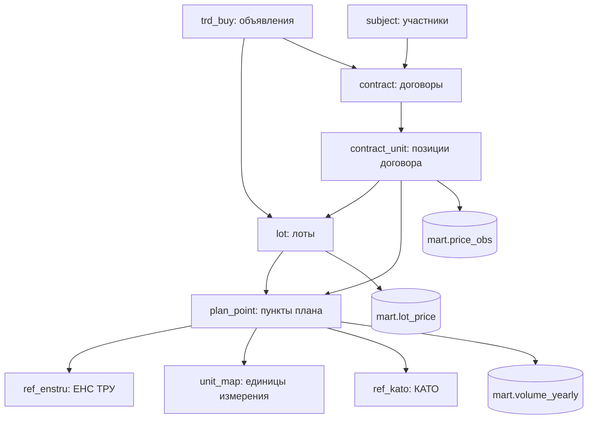

# Схема хранения данных (PostgreSQL)

## raw (как пришло из OWS v3)

Количество строк — на 21.10.2026, после полной загрузки и нескольких инкрементов.

| Таблица | Ключ | Содержимое | Строк |
|---|---|---|---|
| `raw.plans` | id | пункты плана + `PlansKato` + `RefEnstru` | 71 826 |
| `raw.contracts` | id | договоры (все версии) + `ContractUnits` | 37 892 |
| `raw.lots` | id | лоты | 273 599 |
| `raw.trd_buys` | id | объявления | 74 526 |
| `raw.subjects` | bin | участники (заказчики и поставщики) | 9 088 |
| `raw.refs` | (ref, code) | 11 справочников (`ref_units`, `ref_kato`, статусы, способы…) | 17 668 |

## core (очищенные сущности)

| Таблица | Описание и правила |
|---|---|
| `core.plan_point` | типизированные пункты плана; `name_clean = clean_name(name + desc)`; основной КАТО поставки (по наибольшему количеству); флаги `is_active` и `is_deleted` |
| `core.trd_buy` | объявления: способ, статус, дата публикации, `fin_year`, КАТО |
| `core.lot` | лоты: `qty`, `amount`, `plan_point_ids[]`, `kato_code`, `name_clean` |
| `core.contract` | **последняя версия** договора по `rootId` (доп. соглашения создают новые версии с суффиксами /01, /02…) |
| `core.contract_unit` | позиции договора: `item_price` (без НДС), `qty`, `total_sum`, ЕНС ТРУ, ссылки на лот и пункт плана |
| `core.subject` | участники; если карточки в OWS нет, название берётся из лотов или планов |
| `core.ref_units`, `core.unit_map` | справочник ед. изм. и **нормализация**: базовая единица и коэффициент (т→кг ×1000, г→кг ×0.001, м³→л ×1000, дал→л ×10, «100 шт»→шт ×100, пог. м→м …) |
| `core.ref_kato` | КАТО (16 844); функция `core.kato_city()` даёт уровень «город»: для Астаны, Алматы и Шымкента (71/75/79) два знака, для остальных четыре |
| `core.ref_enstru` | названия ЕНС ТРУ (из вложенного `RefEnstru`) |
| `core.ref_status` | статусы и способы закупки |
| `core.cpi` | ИПЦ РК помесячно (01.2024–09.2026 официальные данные; 10–12.2026 оценка по последнему значению, `is_estimate`) |

**Очистка названий** (`core.clean_name`): нижний регистр, удаление кавычек, нумерации («1.», «лот №2)»),
служебных пометок способа («(ЗЦП)», «(тендер)»), лишних пробелов и nbsp, мусорной пунктуации по краям.

## mart (витрины для аналитики и LLM)

| Витрина | Гранулярность | Ключевые поля |
|---|---|---|
| `mart.price_obs` | позиция договора (валидный статус, 2024–2026), 78 582 строки | ЕНС ТРУ, `base_unit`, `unit_price` (за базовую ед.), `unit_price_adj` (приведена по ИПЦ к базовому месяцу), `qty_base`, дата, заказчик, поставщик, область и город поставки, источник КАТО, флаги DQ, ссылки на договор и объявление |
| `mart.enstru_stats` | ЕНС ТРУ × ед. изм. | N, число заказчиков, средневзвешенная, медиана, Q1, Q3, min, max (в ценах базового месяца) |
| `mart.region_coef` | раздел КПВЭД (2 знака ЕНС ТРУ) × область | региональный коэффициент со сжатием к 1 |
| `mart.season_coef` | раздел КПВЭД × месяц | сезонный коэффициент со сжатием к 1 |
| `mart.enstru_unit_mode` | ЕНС ТРУ | доминирующая ед. изм. по пунктам плана (≥ 80% и ≥ 3 наблюдения). Используется для позиций договоров без пункта плана (`unit_source = 'enstru_mode'`) |
| `mart.lot_price` | лот | плановая цена за единицу, ЕНС ТРУ и ед. изм. из плана, КАТО, дата публикации |
| `mart.volume_yearly` | заказчик × ЕНС ТРУ × ед. изм. × год | плановое количество (в базовых ед.), сумма, ID пунктов плана |

**Валидные статусы договора** для цен: подписан, действует, исполнен (полностью или частично), изменён,
передан, расторгнут после подписания, срок истёк. Исключены проекты, «не заключён», отказ, «изменены итоги» и договоры, признанные недействительными по решению суда.

## ops

`ops.sync_state` (watermark по сущности и БИН), `ops.sync_log` (журнал загрузок), `ops.dq_report` (отчёты качества),
`ops.qa_log` (вопросы и ответы агента с Evidence).

## Роли БД

| Роль | Права |
|---|---|
| владелец (`POSTGRES_USER`) | ingestion и ETL |
| `agent_ro` | `SELECT` на `core` и `mart` (в том числе на будущие таблицы через `ALTER DEFAULT PRIVILEGES`), `default_transaction_read_only=on`, `statement_timeout=15s`. Нет доступа к `raw` и `ops`. Под ней работает SQL-инструмент агента |
