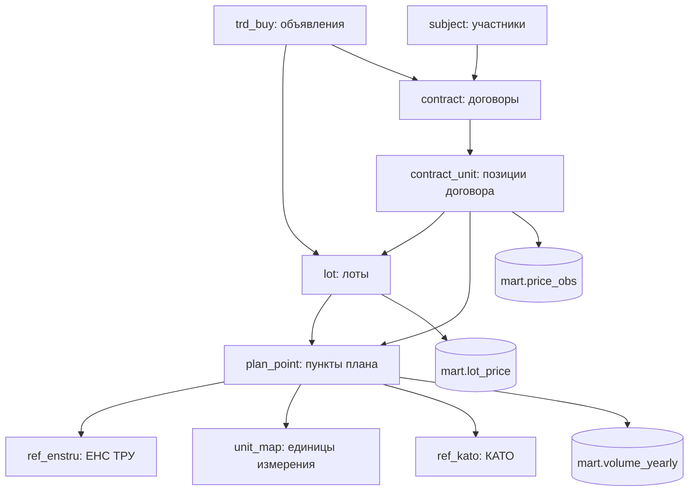

# Схема хранения (PostgreSQL)

## raw — ответы API как есть

Объём на 21.10.2026:

| Таблица | Строк |
|---|---|
| `raw.plans` | 71 826 |
| `raw.contracts` (все версии) | 37 892 |
| `raw.lots` | 273 599 |
| `raw.trd_buys` | 74 526 |
| `raw.subjects` | 9 088 |
| `raw.refs` (11 справочников) | 17 668 |

## core — очищенные сущности

| Таблица | Что делается |
|---|---|
| `plan_point` | типизация, очищенное название, основной КАТО поставки, признак актуальной версии |
| `trd_buy`, `lot` | типизация, связи с планом, очищенные названия |
| `contract`, `contract_unit` | последняя версия договора; позиции с ценой без НДС |
| `subject` | участники; если карточки нет — название из лотов или планов |
| `unit_map` | приведение к базовой единице: т → кг, м³ → л, «100 шт» → шт и т.д. |
| `ref_kato`, `ref_enstru`, `ref_status` | справочники |
| `cpi` | ИПЦ РК помесячно |

**Очистка названий:** регистр, кавычки, нумерация, служебные пометки («(ЗЦП)»), лишние пробелы.

## mart — витрины для агента

| Витрина | Содержимое |
|---|---|
| `price_obs` | позиция договора: ЕНС ТРУ, цена за базовую единицу (в т.ч. с поправкой на ИПЦ), количество, заказчик, поставщик, регион, ссылки (78 582 строки) |
| `enstru_stats` | статистика цен по ЕНС ТРУ: N, средневзвешенная, медиана, квартили |
| `region_coef`, `season_coef` | региональный и сезонный коэффициенты для Fair Price |
| `enstru_unit_mode` | типичная ед. изм. ЕНС ТРУ — для позиций без пункта плана |
| `lot_price` | плановая цена лота за единицу |
| `volume_yearly` | плановое количество по заказчику, ЕНС ТРУ и году |

В сравнении цен участвуют только подписанные договоры (в т.ч. исполненные, изменённые и расторгнутые после подписания); проекты, отказы и признанные недействительными исключены.

## ops и роли

- `ops`: watermark синхронизации, журнал загрузок, отчёты качества, журнал вопросов агента.
- Роль `agent_ro`: только `SELECT` на `core` и `mart`, read-only, таймаут 15 с. Под ней работает SQL-инструмент агента.
